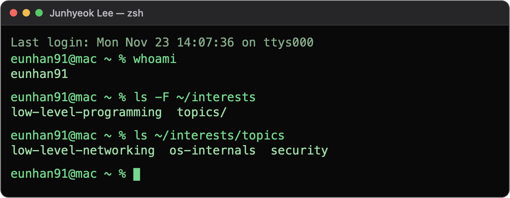

## `eunhan91@mac ~ % ls study/`

- [`2026-2-DS-Study/`](https://github.com/eunhan91/2026-2-DS-Study) · 2026학년도 가을학기 자료구조 과제, 정올 풀이, 실습
- [`cpp_study/`](https://github.com/eunhan91/cpp_study) · C++ 학습 코드
- [`boj-solutions/`](https://github.com/eunhan91/boj-solutions) · 백준 온라인 저지 C++17 풀이
- [`Python_study/`](https://github.com/eunhan91/Python_study) · 2025학년도 봄학기 Python 기초 예제와 과제
- [`Web_study/`](https://github.com/eunhan91/Web_study) · 2025학년도 봄 학기 인터넷과웹기초 실습과 과제

## `eunhan91@mac ~ % ls projects/`

- [`lost_and_found/`](https://github.com/eunhan91/lost_and_found) · 공공 API로 유실물을 검색하고 보관 장소를 지도에서 확인하는 웹 프로젝트
